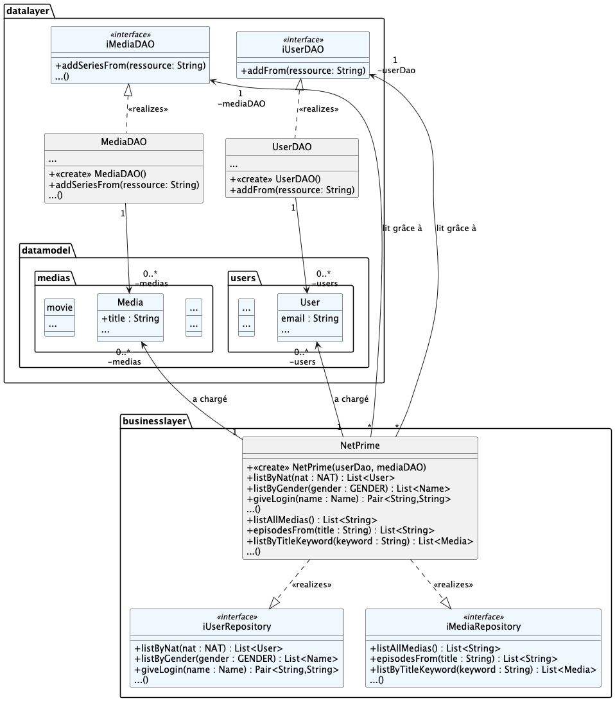
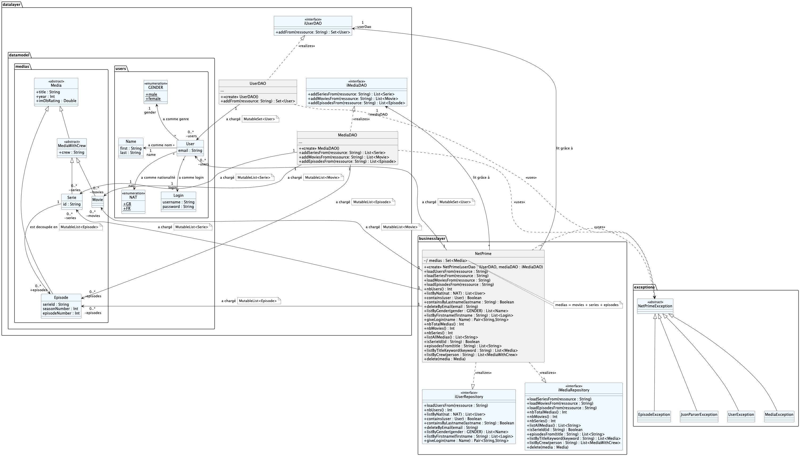
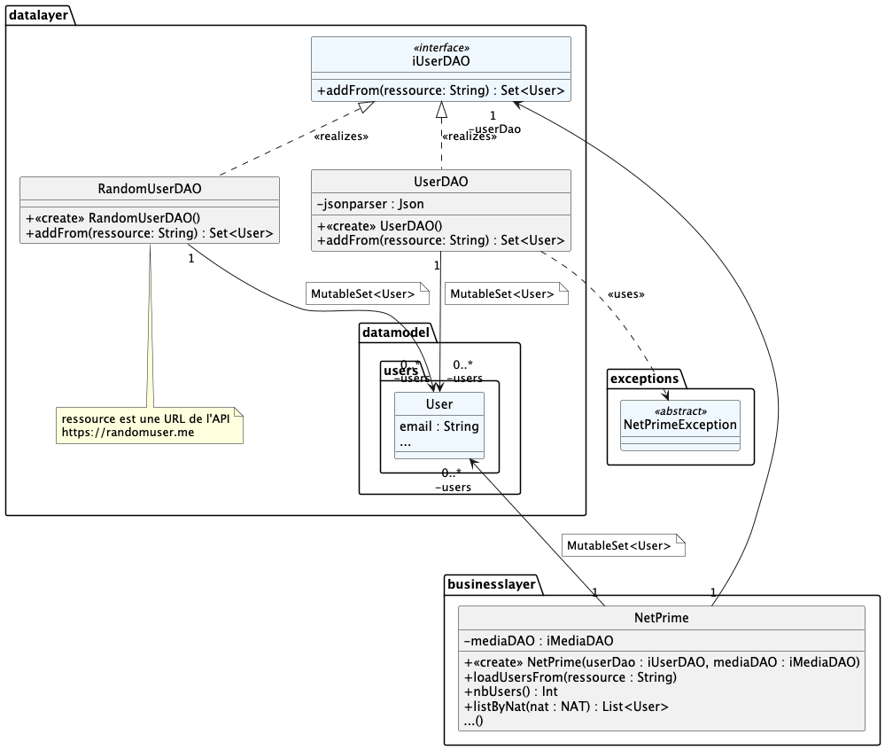

# qdev.dp.tp6

## Exemple jouet de lecture/conversion d'un fichier JSON

On va voir comment lire un fichier contenant
des données au format JSON et convertir ses données JSON en objets Koltin : on parle de _désérialisation_.

Dans le package `truc`, considérez la classe suivante

    @Serializable
    data class Truc(val x: Int, val s : String) 

Nb : c'est une `data class` ; kezako ?

L'annotation `@Serializable` indique que l'on pourra sérialiser/désérialiser cette classe

Dans `truc/Main.kt`,

on commence par instancier un objet `Json`.

Considérez ensuite la chaine de caractères au format JSON suivante :

    {"x":42, "s":"reponse"}

On peut facilement instancier un objet `Truc` à partir de cette simple chaine de caractères, c'est à dire qu'on va
convertir la chaine
de caractères JSON en un objet Kotlin de type `Truc` :

    untruc : Truc = jsonparser.decodeFromString<Truc>(str)

Ou bien à partir d'un fichier `.json` contenant la même chaine de caractère :

        untruc = jsonparser
        .decodeFromStream<Truc>(
            File("data/truc.json").inputStream()
        )

1. on ouvre un flux sur le fichier `truc.json` dans le répertoire `data/` du projet
2. on décode le contenu du fichier en un objet de type `Truc`

Et si le fichier `.json` contient une liste de `Truc`s alors, c'est similaire

       val trucs : List<Truc> = jsonparser
        .decodeFromStream<List<Truc>>(
           File("data/trucs.json").inputStream()
        )

Ici, on convertit le contenu du fichier `trucs.json` en une liste d'objets `Truc`.

Vous pouvez modifier les exemples donnés ici pour tester la désérialisation de vos propres données.

De manière similaire, on peut aussi sérialiser un objet Kotlin en une chaine de caractères JSON où dans un fichier
`.json`.

>
> Pour pouvoir serialiser/désérialiser des objets JSON, on utilise ici une librairie spécifique `kotlinx-serialization`;
> notez dans `build.gradle.kts `la section suivante :
>
> 		dependencies {
>           ...  
> 	    	implementation("org.jetbrains.kotlinx:kotlinx-serialization-json:X.X.X")
>           ....
> 		}
>
> Cette instruction demande à Gradle de télécharger la librairie `kotlinx-serialization` ;
> sans cette librairie, on ne pourrait pas utiliser l'annotation `@Serializable` et les méthodes `Json.decodeFrom...()`.
>
>  L'instruction suivante permet d'activer le plugin de serialization :
>
>       plugins {
>            ...
>            kotlin("plugin.serialization") version "x.x.x"
>           ...
>       }
>
> Pour aller plus loin [voir Serialization](https://kotlinlang.org/docs/serialization.html)
>

## Mise en oeuvre dans le TP n°6 > le projet NetPrime

Considérez le diagramme de classes "simplifié" suivant :

### Objectifs

> [!NOTE] Le travail à réaliser est détaillé étape par étape un peu plus bas dans l'énoncé ; respectez bien ces étapes.

Les classes et interfaces en BLEU vous seront fournies et ne devront pas être modifiées.

Le modèle de données à manipuler est défini dans le paquetage `datalayer.datamodel` : `datalayer.datamodel.medias`
contient des classes de données pour les
séries et les épisodes et `datalayer.datamodel.users` pour les utilisateurs.

Le package `datalayer` contient également deux classes d'accès aux données (DAO) : `UserDAO` et `MediaDAO`, devant
implémenter les interfaces `iUserDAO` et `iMediaDAO` respectivement :
ces DAO s'occuperont de lire les données à partir de fichiers JSON.

Le package `businesslayer` contient la classe `NetPrime` qui devra implémenter les interfaces `iUserRepository` et
`iMediaRepository` ;
Il s'agira d'un _entrepôt de données_, c'est-à-dire d'une classe
fournissant des méthodes de haut niveau de traitement des données (filtres, tris, etc.) correspondant aux besoins
métiers de l'application.

### Travail à réaliser

La documentation précise des méthodes à implémenter est donnée dans les interfaces.

> [!INFO] Dans `data/` on vous a fourni des exemples de fichiers JSON contenant des données d'utilisateurs, de films, de
> séries
> et d'épisodes.
> Les JSON fournis contiennent plus d'informations que celles exploitées par les objets correspondant
> dans les paquetages `users` et `medias`.
> Dans le JSON des series, l'`id` doit correspondre au `serieId` des JSON des épisodes.

Le diagramme de classes complet est donné maintenant :

##### Etape n°1

Implémentez le DAO `UserDAO` afin de lire des fichiers JSON contenant des données d'utilisateurs et de les convertir en
objets `User`.

> [!IMPORTANT]
> Des cas de tests vous sont fournis dans `TestUMLUserDAO` et `TestUsageUserDAO` (`.ktest` -> `.kt`)
> pour valider votre implémentation.

##### Etape n°2

Implémentez la partie de la classe `NetPrime` correspondant à la gestion des utilisateurs, c'est-à-dire l'interface
`iUserRepository`.

> [!IMPORTANT]
> Des cas de tests vous sont fournis dans `TestUMLNetPrime` et `TestUsageNetPrimeUser` (`.ktest` -> `.kt`)
> pour valider votre implémentation.

##### Etape n°3

Implémentez le DAO `MediaDAO` afin de lire des fichiers JSON contenant des données de médias (films, séries, épisodes)
et de les convertir en objets `Media` (et sous-classes).

> [!IMPORTANT]
> Des cas de tests vous sont fournis dans `TestUMLMediaDAO` et dans  `TestUsageMediaDAO` (`.ktest` -> `.kt`)
> pour valider votre implémentation.

##### Etape n°4

Implémentez la partie de la classe `NetPrime` correspondant à la gestion des médias, c'est-à-dire l'interface
`iMediaRepository`.

> [!IMPORTANT]
> Des cas de tests vous sont fournis dans dans  `TestUsageNetPrimeMedia` (`.ktest` -> `.kt`)
> pour valider votre implémentation.
>
>

### Pour aller plus loin

Ajoutez une nouvelle classe DAO `RandomUserDAO` implémentant également l'interface `iUserDAO`
mais qui ira maintenant récupérer des données d'utilisateurs depuis l'API [RandomUser](https://randomuser.me/).

> [!TIP] Pour réaliser la connexion cliente HTTP, vous pouvez utiliser la
> librairie [Ktor Client](https://ktor.io/docs/getting-started-ktor-client.html).

> [!IMPORTANT]
> Des cas de tests vous sont fournis dans `TestUsageRandomUserDAO` et `TestUsageNetPrimeRandomUser`
> (`.ktest` -> `.kt`) pour valider votre implémentation.

