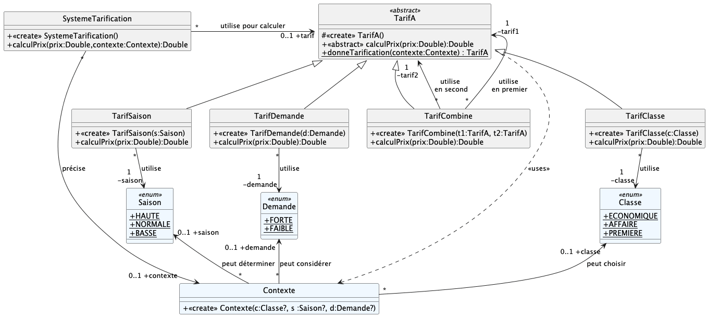
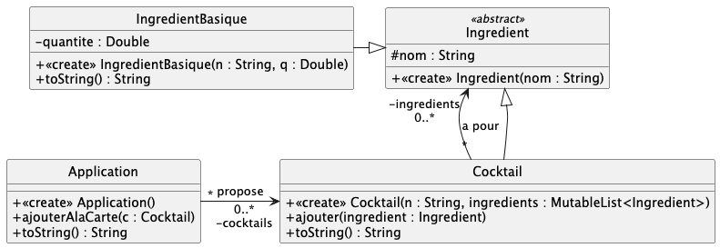
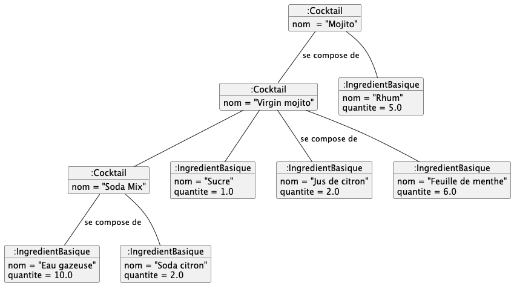

# qdev.dp.tp7

Implémenter les deux études de cas étudiées en TDs.

> [!NOTE]
> Renommez au fur et à mesure les fichiers `.ktest` en `.kt` pour les inclure dans les fichiers de test.

## Exercice 1 : système de tarification des vols

Il s'agit d'implémenter le cas d'étude à propos du système de tarification des vols, résumé par le diagramme de classes suivant.

Quelques précisions sur les règles de calcul des tarifs. Tous les prix sont des `Double` (en €), sans arrondi particulier :

- Le tarif *en fonction de la saison* multiplie le prix par 1,2 en haute saison (+20%), par 0,85 en basse saison (-15%), et le laisse inchangé en saison normale.
- Le tarif *en fonction de la classe* laisse le prix inchangé en classe économique, le multiplie par 1,5 en classe affaire et par 3 en première classe.
- Le tarif *en fonction de la demande* ajoute 50.0 € si la demande est forte. Si la demande est faible, il retire 25.0 € du prix reçu, à condition que le résultat soit supérieur ou égal à la moitié de ce prix reçu (c'est-à-dire pour un prix reçu supérieur ou égal à 50.0 €) ; sinon le prix est inchangé.
- Le tarif combiné applique en premier la règle de calcul de `tarif1`, puis applique celle de `tarif2` au résultat obtenu.

Tous les tarifs refusent un prix négatif en entrée : `calculPrix` lève alors une `PrixNegatifException`. Appliqués à un prix positif ou nul, ils ne produisent jamais de prix négatif.

Dans le contexte, on peut préciser un choix de classe, de saison ou de demande (`null` sinon). La fabrique `TarifA.donneTarification` construit le tarif en combinant, dans cet ordre de priorité (classe, puis saison, puis demande), uniquement les tarifs dont le choix est renseigné. Si aucun choix n'est renseigné, elle lève une `ContexteImpossibleException`.

Le système de tarification mémorise le dernier contexte (`contexte`) et le tarif correspondant (`tarif`). Il ne reconstruit le tarif que si le contexte reçu n'est pas égal (`equals`) au contexte mémorisé.

> [!IMPORTANT]
> Les tests `TestUML*` vérifient la conformité stricte au diagramme de classes.
> Les tests `TestUsage*` vérifient le comportement fonctionnel.

## Exercice 2 : recettes de cocktails

Il s'agit d'implémenter le cas d'étude à propos du système de recettes de cocktails, résumé par le diagramme de classes suivant :

Le diagramme d'objets suivant illustre une carte composée de trois cocktails imbriqués :

Quelques précisions :

- Un `Cocktail` est lui-même un `Ingredient` : il peut donc contenir des ingrédients basiques **et** d'autres cocktails (par exemple, le *Mojito* contient le *Virgin mojito*, qui contient le *Soda Mix*). 
On suppose qu'un cocktail ne se contient pas, directement ou indirectement, lui-même.
- Le paramètre `ingredients` du constructeur de `Cocktail` est optionnel : `Cocktail("Soda Mix")` crée un cocktail sans ingrédient (liste vide). 
Lorsqu'une liste est fournie, elle est conservée telle quelle (pas de copie).
- Les ingrédients d'un cocktail conservent leur ordre d'ajout, qui est celui utilisé par `toString()`.
- Formats attendus des `toString()` (les quantités sont des `Double`, sans unité) :

  | Classe | Format | Exemple |
  |---|---|---|
  | `IngredientBasique` | `nom [quantité]` | `Eau gazeuse [10.0]` |
  | `Cocktail` | `nom : [ingrédient1, ingrédient2, ...]` | `Soda Mix : [Eau gazeuse [10.0], Soda citron [2.0]]` |
  | `Application` | `[cocktail1, cocktail2, ...]` | `[Soda Mix : [Eau gazeuse [10.0], Soda citron [2.0]], ...]` |

> [!IMPORTANT]
> Les tests `TestUML*` vérifient la conformité stricte au diagramme de classes. 
> Le test `TestUsageCocktails` vérifie le comportement fonctionnel, en particulier les formats ci-dessus.
